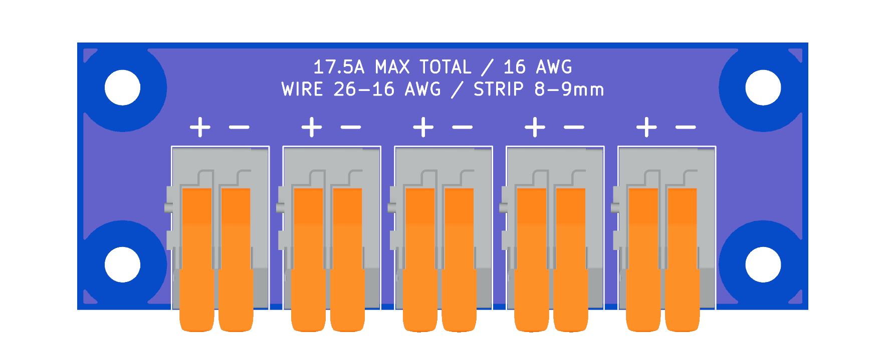
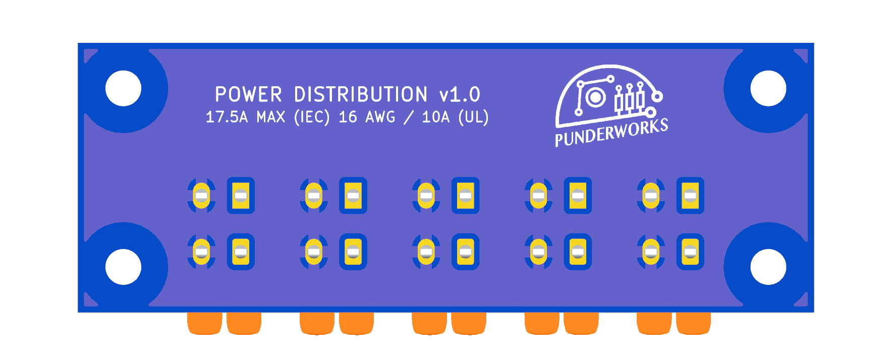
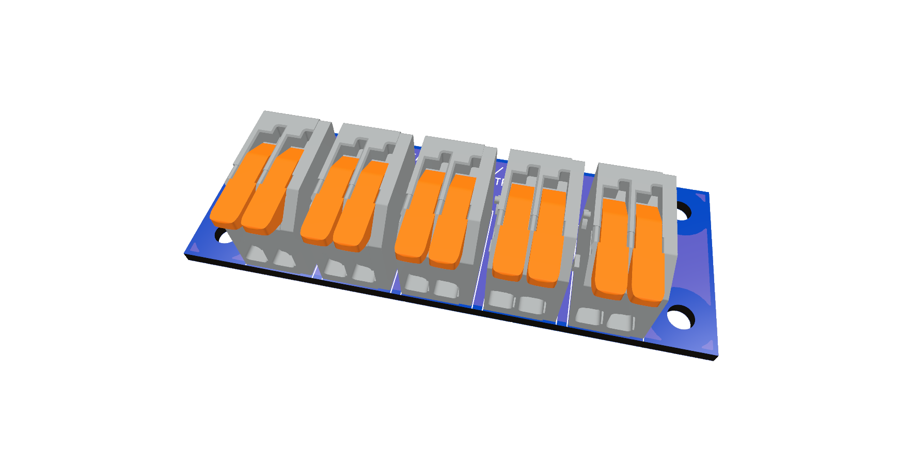

# Inline Distribution Board

Five identical 2-pole terminals in a single row share a V+ plane (`VPWR`, top copper) and a ground
plane (`GND`, bottom copper). Any terminal can be the input; the other four are outputs. There are no
active or passive components.

This is the [distribution board](../distribution/README.md) laid out in one row instead of a 3 x 2 grid,
for where a long, narrow board fits better. The terminal, ratings and design decisions are the same;
only the layout differs, and that is described here.

  
  

  

## Features

- **One in, four out, any way round.** Every terminal is the same, so any one can be the input.
- **17.5 A total** through solid copper planes on both layers, with 16 AWG wire.
- **Tool-free wiring.** WAGO 2601 lever terminals take 26-16 AWG wire; strip 8-9 mm and push it in.
- **Long and narrow.** 65.5 x 24 mm, with every wire leaving from the same edge.
- **Safe to mount with metal hardware.** Four M3 holes with copper kept clear of each.
- **Five parts, all through-hole.**

## Ratings

| | |
|---|---|
| Current | **17.5 A total** through whichever terminal is the input, with 16 AWG wire (IEC/EN 60664-1 rating of the terminals). **10 A** if you need the UL/CSA rating. |
| Wire | 26-16 AWG solid, 24-16 AWG fine-stranded. Strip 8-9 mm. |
| Voltage | DC power distribution, far below the terminals' 160 V IEC / 300 V UL rating. |
| Polarity | `+` and `-` are printed behind every terminal. Any terminal can be the input. |
| Mounting | Four M3 holes. Screws and standoffs may be metal: copper is kept clear of every hole. |

The input terminal carries the sum of every output's current, so the 17.5 A limit applies to the total,
not to each output. See the [distribution board README](../distribution/README.md#terminal-wago-2601-1102)
for the terminal's datasheet figures.

The electrical design is in [Stackup KDL](stackup/board.kdl), using the shared
[parts file](../libraries/stackup/parts.kdl). The KiCad PCB (`distribution-inline.kicad_pcb`) is linked
to it through `distribution-inline.stackup_sch`; sync it with the Stackup KiCad plugin. Run
`stackup check PCB/distribution-inline/stackup/board.kdl --locked` from the repository root before
syncing.

## What to buy

The purchasing BOM is [`production/bom/distribution-inline-bom.csv`](production/bom/distribution-inline-bom.csv), exported from
the Stackup design (`stackup bom PCB/distribution-inline/stackup/board.kdl --locked`).

| Qty | Ref | Part | Manufacturer / MPN | Mouser | DigiKey | LCSC |
|---|---|---|---|---|---|---|
| 5 | J1-J5 | Lever terminal, 2-pole, 3.5 mm, horizontal entry | WAGO 2601-1102 | 1089-2601-1102 | 2946-2601-1102-ND | C7509568 |
| 4 | — | M3 screws and standoffs to mount the board (not on the BOM) | Any; metal is fine, copper is kept clear of the holes | | | |

The 2601-3102 is the vertical, top-entry version of the same block; it is not a substitute.

## Ordering

Fab files are in [`production/`](production/), regenerated with `scripts/export_production.sh distribution-inline`
from the repository root:

| File | Contents |
|---|---|
| [`production/jlcpcb/distribution-inline-gerbers.zip`](production/jlcpcb/distribution-inline-gerbers.zip) | Everything a fab needs to make the bare board: upload this |
| [`production/gerbers/`](production/gerbers/) | The same files unzipped: Gerbers (X2, Protel extensions), PTH and NPTH Excellon drills, drill maps, job file |
| [`production/bom/distribution-inline-bom.csv`](production/bom/distribution-inline-bom.csv) | Purchasing BOM with Mouser, DigiKey and LCSC numbers |
| [`production/placement/distribution-inline-pos.csv`](production/placement/distribution-inline-pos.csv) | Placement file (mm), for an assembler |

Board options: **65.5 x 24 mm, 2 layers, 1.6 mm FR-4, 1 oz copper, blue solder mask, white silkscreen**,
any surface finish (HASL lead-free is fine). Every feature is far above standard fab minimums. The five terminals are through-hole and quick to hand-solder; JLCPCB can also assemble them (LCSC C7509568).

## Assembly

1. Fit the 5 terminals with their wire entries at the board edge and solder both pins of each pole.
   The pins carry the full current, so make them full, shiny fillets.
2. Check continuity between all 5 `+` pins and between all 5 `-` pins, and that `+` and `-` are
   not shorted.
3. Wire the supply to any one terminal and the loads to the others, keeping the total within the rating.

## Hardware overview

| Ref | Function | Part |
|---|---|---|
| J1-J5 | Power terminal, input or output | WAGO 2601-1102 |

Every terminal has pin 1 (square pad, `+` on the silkscreen) on `VPWR` and pin 2 (`-`) on `GND`.

## Layout

- **65.5 x 24 mm, one row.** J1-J5 sit on the same 10 mm pitch as the 3 x 2 board (8.5 mm body plus
  room to work the levers), all with their wires entering from the bottom edge. The wire entry faces
  are flush with that edge, so the 10 `silk_edge_clearance` DRC warnings (two per terminal) are
  expected, as on the 3 x 2 board.
- **Ratings across the top.** A single row leaves no side strips tall enough for text, so "17.5A MAX
  TOTAL / 16 AWG" and "WIRE 26-16 AWG / STRIP 8-9mm" run as two lines along the top edge, above the `+`
  and `-` marks.
- **Four M3 mounting holes on side extensions**, two each side, each centre 4.45 mm from the nearest
  terminal body, with the same 8 mm copper keep-out on both layers.
- **Planes, not traces.** V+ on top and GND on the bottom span the whole board, joined to the pads
  through thermal reliefs with 1.0 mm spokes (8 mm of copper per pole), as on the 3 x 2 board.
- **Back:** the 10 mm PunderWorks logo beside "POWER DISTRIBUTION" and the IEC/UL ratings.

## Bench checklist

- Before connecting a load, check continuity between all five `+` pins and between all five `-` pins,
  and confirm there is no short between V+ and GND.
- Run the full intended load through the input and one output, and check the input terminal and the
  board near it for heating.
