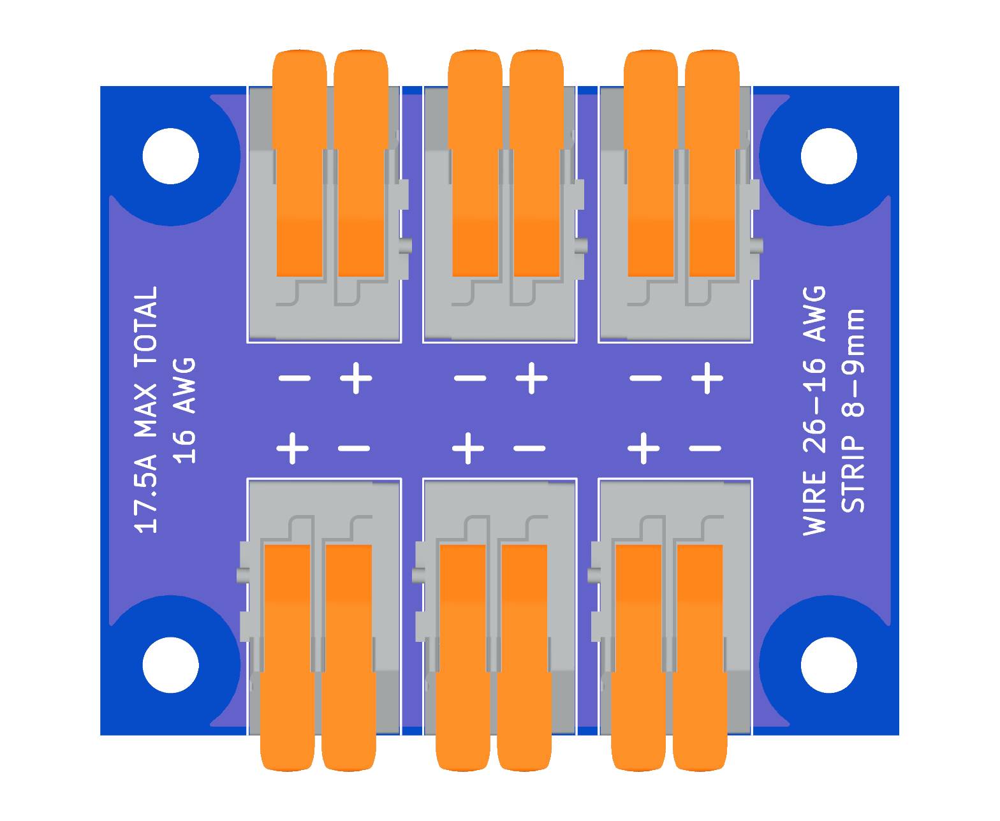
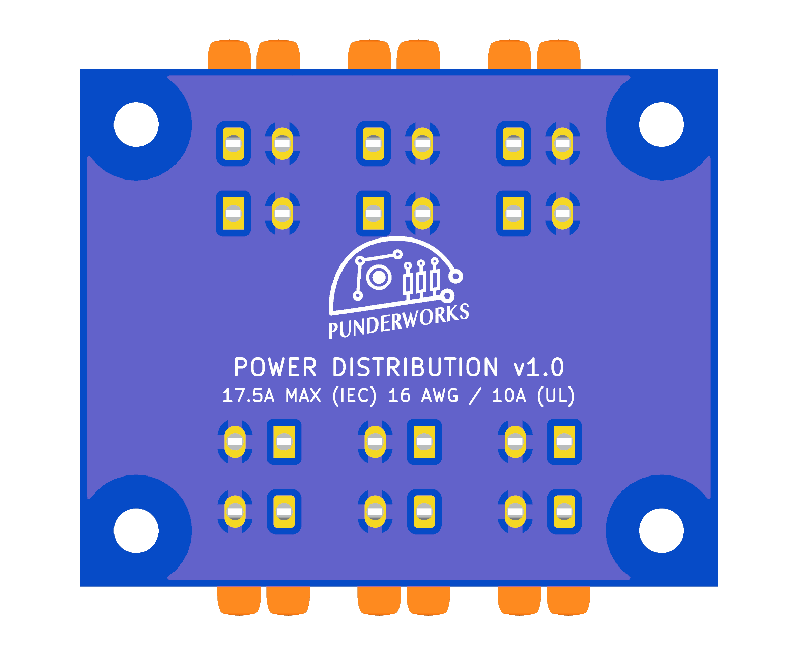
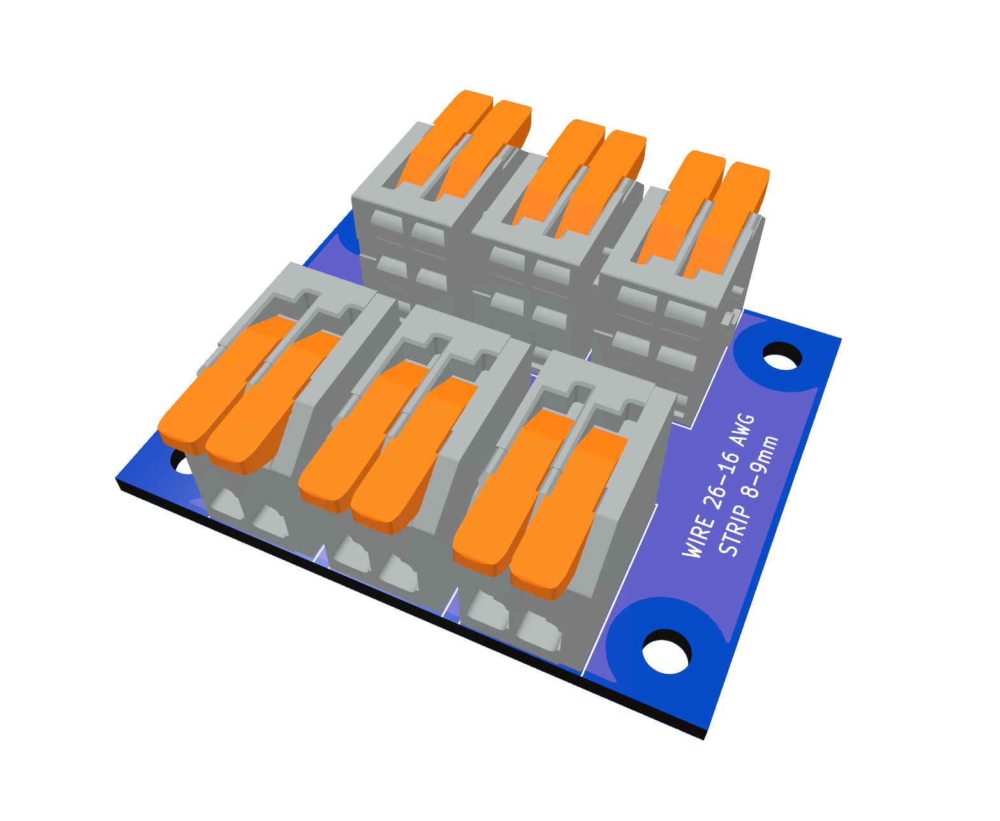

# Distribution Board

Six identical 2-pole terminals share a V+ plane (`VPWR`, top copper) and a ground plane (`GND`,
bottom copper). Any terminal can be the input; the other five are outputs. There are no active or
passive components. For a long, narrow version with five terminals in one row, see the
[inline distribution board](../distribution-inline/README.md).

  
  

  

## Features

- **One in, five out, any way round.** Every terminal is the same, so any one can be the input.
- **17.5 A total** through solid copper planes on both layers, with 16 AWG wire.
- **Tool-free wiring.** WAGO 2601 lever terminals take 26-16 AWG wire; strip 8-9 mm and push it in.
- **Compact.** 45.5 x 37 mm, with the wires leaving from two opposite edges.
- **Safe to mount with metal hardware.** Four M3 holes with copper kept clear of each.
- **Six parts, all through-hole.**

## Ratings

| | |
|---|---|
| Current | **17.5 A total** through whichever terminal is the input, with 16 AWG wire (IEC/EN 60664-1 rating of the terminals). **10 A** if you need the UL/CSA rating. |
| Wire | 26-16 AWG solid, 24-16 AWG fine-stranded. Strip 8-9 mm. Use 16 AWG for full current; thinner wire limits the current to what that wire can carry. |
| Voltage | DC power distribution. The terminals are rated far above any battery system (160 V IEC, 300 V UL). |
| Polarity | `+` and `-` are printed behind every terminal. Any terminal can be the input. |
| Mounting | Four M3 holes. Screws and standoffs may be metal: copper is kept clear of every hole. |

The input terminal carries the sum of every output's current, so the 17.5 A limit applies to the total,
not to each output.

The electrical design is in [Stackup KDL](stackup/board.kdl), using the shared [parts file](../libraries/stackup/parts.kdl). The KiCad PCB
(`distribution.kicad_pcb`) is linked to it through `distribution.stackup_sch`; sync it with the Stackup
KiCad plugin. Run `stackup check PCB/distribution/stackup/board.kdl` from the repository root
before syncing.

## What to buy

The purchasing BOM is [`production/bom/distribution-bom.csv`](production/bom/distribution-bom.csv), exported from
the Stackup design (`stackup bom PCB/distribution/stackup/board.kdl --locked`).

| Qty | Ref | Part | Manufacturer / MPN | Mouser | DigiKey | LCSC |
|---|---|---|---|---|---|---|
| 6 | J1-J6 | Lever terminal, 2-pole, 3.5 mm, horizontal entry | WAGO 2601-1102 | 1089-2601-1102 | 2946-2601-1102-ND | C7509568 |
| 4 | — | M3 screws and standoffs to mount the board (not on the BOM) | Any; metal is fine, copper is kept clear of the holes | | | |

The 2601-3102 is the vertical, top-entry version of the same block; it is not a substitute.

## Ordering

Fab files are in [`production/`](production/), regenerated with `scripts/export_production.sh distribution`
from the repository root:

| File | Contents |
|---|---|
| [`production/jlcpcb/distribution-gerbers.zip`](production/jlcpcb/distribution-gerbers.zip) | Everything a fab needs to make the bare board: upload this |
| [`production/gerbers/`](production/gerbers/) | The same files unzipped: Gerbers (X2, Protel extensions), PTH and NPTH Excellon drills, drill maps, job file |
| [`production/bom/distribution-bom.csv`](production/bom/distribution-bom.csv) | Purchasing BOM with Mouser, DigiKey and LCSC numbers |
| [`production/placement/distribution-pos.csv`](production/placement/distribution-pos.csv) | Placement file (mm), for an assembler |

Board options: **45.5 x 37 mm, 2 layers, 1.6 mm FR-4, 1 oz copper, blue solder mask, white silkscreen**,
any surface finish (HASL lead-free is fine). Every feature is far above standard fab minimums. The six terminals are through-hole and quick to hand-solder; JLCPCB can also assemble them (LCSC C7509568).

## Assembly

1. Fit the 6 terminals with their wire entries at the board edge and solder both pins of each pole.
   The pins carry the full current, so make them full, shiny fillets.
2. Check continuity between all 6 `+` pins and between all 6 `-` pins, and that `+` and `-` are
   not shorted.
3. Wire the supply to any one terminal and the loads to the others, keeping the total within the rating.

## Hardware overview

| Ref | Function | Part |
|---|---|---|
| J1-J6 | Power terminal, input or output | WAGO 2601-1102 |

Every terminal has pin 1 (square pad, `+` on the silkscreen) on `VPWR` and pin 2 (`-`) on `GND`.

## Terminal: WAGO 2601-1102

Lever-actuated Push-in CAGE CLAMP, 2-pole, 3.5 mm pitch, wire entry parallel to the PCB.
From the [WAGO data sheet](../datasheets/WAGO_2601-1102.pdf) (version 25.01.2023):

| Spec | Value | Source |
|---|---|---|
| Wire, solid | 0.14-1.5 mm² / 26-16 AWG | p. 2 |
| Wire, fine-stranded | 0.2-1.5 mm² / 24-16 AWG | p. 2 |
| Strip length | 8-9 mm | p. 2 |
| Rated current | 17.5 A (IEC/EN 60664-1); 10 A (UL 1059 / CSA, Use Groups B and D) | p. 2 |
| Wire entry angle to PCB | 0° | p. 2 |
| Solder pins | 2 per pole, rows 5 mm apart, 1.2 (+0.1) mm hole | p. 1, p. 3 |

The 2601-3102 is the vertical, top-entry version of the same block; it is not a substitute.

## Design decisions

- **Current limit is the input terminal.** Whichever terminal is used as the input carries the sum of
  all the outputs. The board is rated to the terminals' 17.5 A IEC/EN 60664-1 rating, which assumes
  16 AWG (1.5 mm²), the largest wire they take. Their 10 A UL/CSA rating is given for anyone who needs
  it. The overvoltage categories in the WAGO ratings table apply to the voltage ratings, not the current.
- **Ratings on the silkscreen.** The side strips read "17.5A MAX TOTAL / 16 AWG" and "WIRE 26-16 AWG /
  STRIP 8-9mm", and the back carries the IEC and UL figures.
- **Logo.** The PunderWorks logo (`PowerBoards:PunderWorks_Logo_10mm`, 10 x 7.35 mm) on the back,
  between the terminal rows above the title, as on the Snips board. It is a board-only silkscreen
  footprint generated by `scripts/make_logo_footprint.py`; see the regulator README for regenerating it.
- **No input or output labels.** Any terminal can be the input, so the silkscreen marks only `+` and `-`.
- **3 x 2 grid, rows back to back.** J1-J3 form the top row, rotated 180° so their wires enter from
  the top edge. J4-J6 form the bottom row, with wires entering from the
  bottom edge. Columns are on a 10 mm pitch (8.5 mm body plus room to work the levers), and an 8 mm gap
  between the rows holds the polarity labels. Seen from its own edge, every terminal has `+` on the left.
- **Wire entry faces are flush with the top and bottom board edges**, so the wires leave the board and
  the levers (16.58 mm deep including the lever, versus a 14.5 mm body) overhang the edge. This puts the
  footprints' silkscreen outlines across the edge: the 12 `silk_edge_clearance` DRC warnings are
  expected and the fab clips that silkscreen.
- **Four M3 mounting holes, one per corner.** KiCad `MountingHole_3.2mm_M3` (3.2 mm unplated), placed
  on side extensions beside the terminals, with each hole centre 4.5 mm from the nearest terminal body.
  They are board-only footprints in the layout, not Stackup parts: Stackup sync leaves board-only
  footprints alone, and they stay out of the BOM and placement files.
- **Copper keep-out around each hole.** An 8 mm diameter rule area on both copper layers keeps the V+ and
  GND planes away from the screw head and standoff. Otherwise a metal screw would sit on V+ copper on
  top and GND on the bottom with only solder mask between them.
- **Planes, not traces.** At 17.5 A, IPC-2221 needs about 15.7 mm of 1 oz outer copper for a 10 °C
  rise (7.2 mm at 10 A). Each plane spans the whole 45.5 x 37 mm board. Pads join their plane through thermal reliefs with
  1.0 mm spokes; with two solder pins per pole, that is 8 spokes (8 mm of copper) per pole.

## Bench checklist

- Before connecting a load, check continuity between all six `+` pins and between all six `-` pins, and
  confirm there is no short between V+ and GND.
- Run the full intended load through the input and one output, and check the input terminal and the
  board near it for heating.
