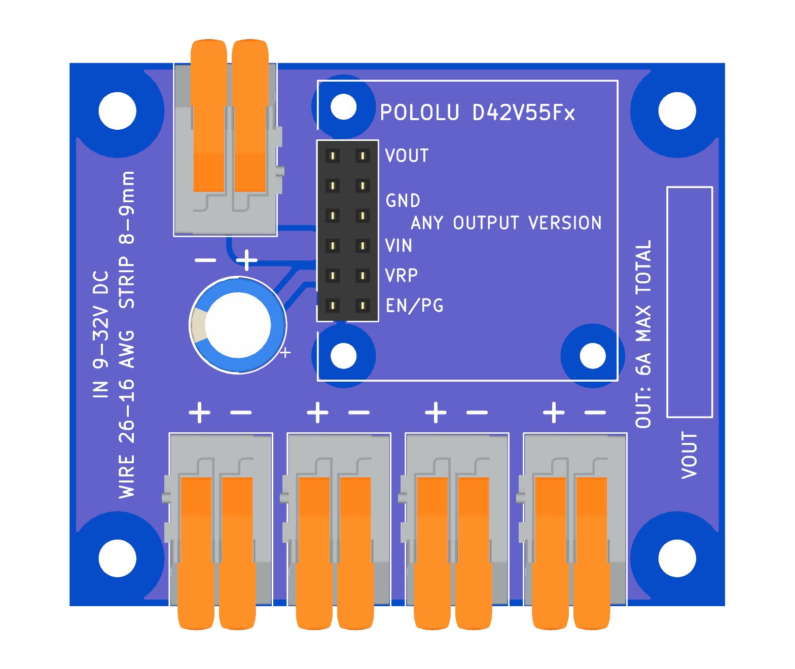
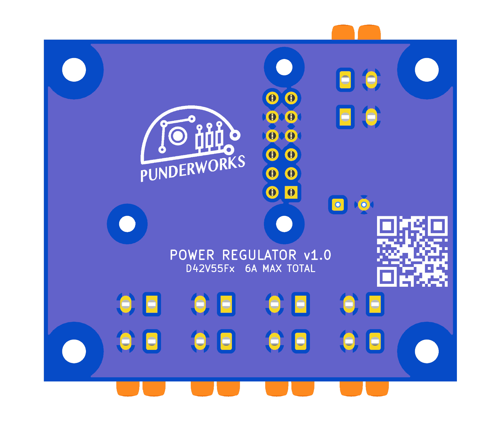
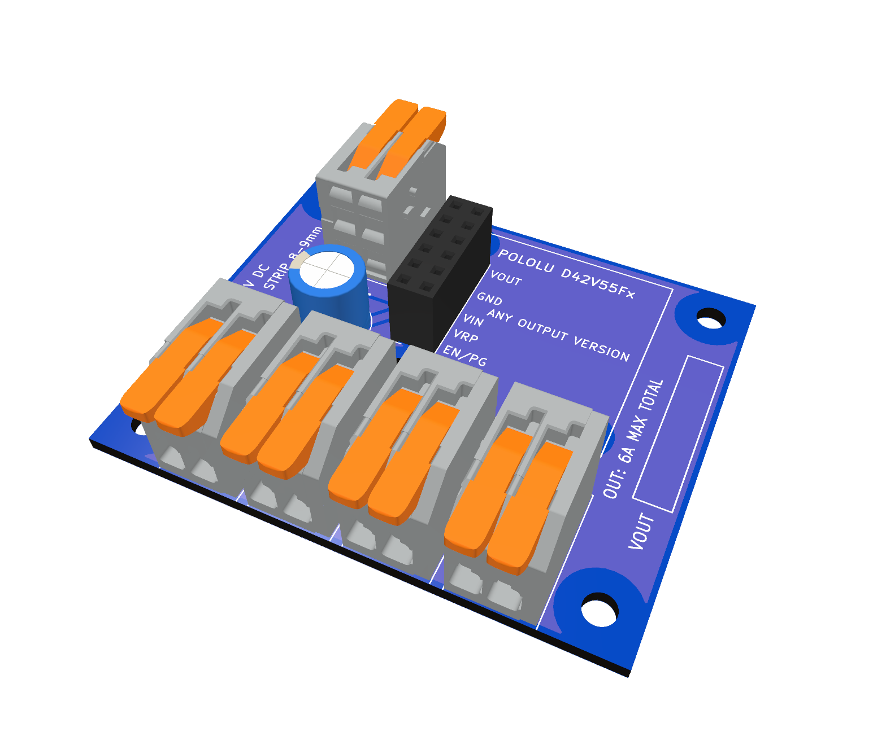

# Regulator Board

A power distribution board with a plug-in step-down regulator. One WAGO terminal takes the battery and
feeds a Pololu D42V55Fx module plugged into a socket in the middle of the board; the module's output
feeds a V+ plane shared by four more WAGO terminals, over a GND plane. The output voltage is whichever
module is plugged in: **D42V55F5 for 5 V, D42V55F12 for 12 V**, or any other D42V55Fx version.
Swapping the module changes the board's output; nothing else on the board changes.

  
  

  

## Features

- **Battery in, regulated power out to four terminals.** 9-32 V in (24 V batteries up to 32 V
  peak, or 12 V systems with the 5 V module), up to 6 A out in total.
- **Plug-in regulator.** The Pololu module sits in a socket on its own headers, so one board covers
  every output voltage, and a module can be swapped without desoldering anything.
- **Tool-free wiring.** WAGO 2601 lever terminals take 26-16 AWG wire; strip 8-9 mm and push it in.
- **Protected input.** The module has reverse-polarity, over-current and over-temperature
  protection. An input capacitor on the board damps the voltage spike when a charged battery is
  plugged in (simulated: 42 V worst case instead of 57 V, against the module's 60 V limit).
- **Label it.** A blank `VOUT` box on the silkscreen for the voltage of the module fitted, `+`/`-`
  behind every terminal, and the ratings printed on both sides.
- **All through-hole.** Seven parts plus the module, easy to hand-solder.

## Ratings

| | 5 V (D42V55F5) | 12 V (D42V55F12) |
|---|---|---|
| Input | 9-32 V DC (module: up to 60 V) | 14-32 V DC (module: up to 60 V) |
| Output current, total | **6 A** | **5 A** |
| What limits it | The module's two VOUT header pins, 3 A each | The module's thermal limit, derated for an enclosure |
| Module alone, 24-32 V in, open air | 7.1-6.8 A | 5.9-5.4 A |
| Wire | 26-16 AWG, strip 8-9 mm (WAGO 2601) | Same |

Other D42V55Fx output versions fit the same socket; the board limit is still 6 A, and the module's own
limit comes from Pololu's graph. The four outputs share the total; it is not per output. Input current
is far lower than the output current: about 2.8 A at 24 V in for 12 V x 5 A out. The terminals
(17.5 A IEC) are nowhere near their limit.

Module currents are from Pololu's "maximum continuous output current" graph on the
[product page](../datasheets/Pololu_D42V55F5.html) (room temperature, still air, no heat sinking).
The 9 V and 14 V input minimums are a working allowance for dropout at full load, not Pololu figures;
see the dropout graph on the product page.

## What to buy

### Board parts

The purchasing BOM is [`production/bom/regulator-bom.csv`](production/bom/regulator-bom.csv),
exported from the Stackup design (`stackup bom PCB/regulator/stackup/board.kdl --locked`).

| Qty | Ref | Part | Manufacturer / MPN | Mouser | DigiKey | LCSC |
|---|---|---|---|---|---|---|
| 5 | J1-J5 | Lever terminal, 2-pole, 3.5 mm, horizontal entry | WAGO 2601-1102 | 1089-2601-1102 | 2946-2601-1102-ND | C7509568 |
| 1 | J6 | Module socket: female header 2x6, 2.54 mm, through-hole | Samtec SSW-106-01-T-D | 200-SSW10601TD | 612-SSW-106-01-T-D-ND | C3323806 |
| 1 | C1 | Electrolytic capacitor, 100 µF 63 V, radial 8 x 11.5 mm, 3.5 mm lead spacing | Rubycon 63ZLJ100M8X11.5 | 232-63ZLJ100M8X11.5 | 1189-63ZLJ100M8X11.5-ND | C694359 |

Substitutes: Sullins PPTC062LFBN-RC for J6. For C1, any low-impedance 100 µF 63 V (or higher)
105 °C electrolytic that is 8 mm in diameter with 3.5 mm lead spacing; a 10 mm can has 5 mm spacing
and won't fit the footprint.

### Not on the board

| Qty | Item | Notes |
|---|---|---|
| 1 | Pololu D42V55Fx regulator | [pololu.com/category/354](https://www.pololu.com/category/354). D42V55F5 (#5571) for 5 V, D42V55F12 (#5577) for 12 V, or another version. Comes with the male headers it plugs in on |
| 3 | Round nylon spacer, #2/M2, 3/16" (4.76 mm) OD x 7/16" (11.13 mm), unthreaded: **Bivar 9913-437** | Mouser 749-9913-437, DigiKey 492-1047-ND. Optional but recommended in a moving droid: holds the module down |
| 3 | Nylon pan head screw, M2 x 16 mm, Phillips: **Essentra 50M020040P016** | DigiKey 145-50M020040P016-ND (Mouser 144-50M020040P016). Goes down through the module, the spacer and the board. M2 x 20 (50M020040P020) also works, with more thread below the nut |
| 3 | Nylon hex nut, M2: **Essentra 04M020040HN** | Mouser 144-04M020040HN, DigiKey RPC7084-ND. Under the board |
| 4 | M3 screws and standoffs | To mount the board. Metal is fine: copper is kept clear of the holes |

## Assembly

1. Solder C1 with its `+` lead in the pad nearest the socket (the stripe on the can is `-`), then J6
   and the five WAGO terminals. Keep the socket square to the board so the module sits level.
2. Solder the module's supplied male headers to the module (long pins down), using the socket as a
   jig: plug the headers into J6, sit the module on them, and solder from the top.
3. Before plugging the module in, check there is no short from VIN, VRP or VOUT to GND, and power
   the board from a current-limited supply to check J1 reaches J6.
4. Stand a spacer over each of the three M2 holes (H5-H7), then plug the module in on top, with its
   body over the outline on the silkscreen and its holes over the spacers. Push an M2 x 16 nylon
   screw down through each module hole, spacer and board, and fit a nylon nut underneath. Snug the
   nuts by hand; don't pull the module down harder than the socket seats it. Write the output voltage in the `VOUT` box.
5. Wire the battery to J1 (`IN`) and the loads to J2-J5. The bench checklist below has the first
   power-up checks.

The electrical design is in [Stackup KDL](stackup/board.kdl), using the shared
[parts file](../libraries/stackup/parts.kdl). The KiCad PCB (`regulator.kicad_pcb`) is linked to it
through `regulator.stackup_sch`; sync it with the Stackup KiCad plugin. Run
`stackup check PCB/regulator/stackup/board.kdl --locked` from the repository root before syncing.

## Design decisions

- **A plug-in module, not a regulator on the board.** The board stays passive and through-hole, and one
  PCB covers every output voltage. The D42V55Fx family was chosen over the D36V50Fx for its 60 V input
  (against 50 V), which leaves room above 32 V battery peaks and hot-plug spikes, and for holding more
  current near 32 V in. Its pins are a 2x6 grid on 0.1" pitch in the order EN/PG, VRP, VIN, GND, GND,
  VOUT, with EN on the edge row and PG on the inner row. The dimension drawing puts the edge row 1.27 mm
  and the inner row 3.81 mm from the module edge, with the six positions centered (6.35 mm from each
  end). The D36V50Fx has the same pin order and should fit the same socket, but that is from Pololu's
  pinout photos; its standoff holes have not been checked against these.
- **One input capacitor, no TVS.** With the module alone, simulated hot-plug at 32 V through 0.5-2 µH
  of battery lead peaks at up to 57 V at VIN, close to the 60 V limit. C_IN brings the worst case to 42 V.
  See `scripts/spice/regulator_hotplug_sim.py` (`--bare` for the module alone).
- **C_IN is on VRP, not VIN.** VRP is the module's input after its reverse-voltage protection. A
  polarized capacitor there is never reverse-biased by a battery wired backwards, so there is no need for
  a bipolar capacitor (the 63 V ones are poorly stocked) or a back-to-back pair. The simulation models
  the unpublished protection both as a closed switch and as a bare diode; both pass.
- **No extra output capacitor.** The module carries its own output capacitors, and Pololu gives no
  guidance on adding more.
- **EN and PG unconnected.** The module pulls EN up to VIN through 1 MΩ, so it is always on. No on/off
  switch, LED, servo headers, USB or VIN passthrough: the board is meant to stay simple. A distribution
  board on the battery side gives a passthrough if one is needed.
- **Inspiration:** the Sure Robotics DC Converter (6 A, 9-36 V in, 5/6 V out, four screw-terminal
  outputs).

## Layout

55.5 x 46 mm, two layers, 1 oz copper. Top copper is a VOUT pour, bottom copper a GND pour, both over
the whole board, joined to pads through thermal reliefs with 1.0 mm spokes (as on the distribution
board). VIN runs as a 2.5 mm top trace from J1 to the socket (1.5 mm along the socket row, between the
VRP and GND pins); VRP is a 1.0 mm trace from the socket to C1.

- **J1 (input) alone on the top edge, J2-J5 (outputs) on the bottom edge,** wires entering from the
  edge, on the distribution board's 10 mm pitch. Keeping the input on its own edge makes it hard to
  wire a battery into an output. `+`/`-` sit behind every terminal body.
- **Module in the middle, socket on its left edge.** The socket is rotated so EN/PG is at the bottom and
  VOUT at the top, which puts VIN facing J1 and VRP beside C1. The module body (25.4 mm square, outlined
  on the silkscreen with its pin names inside) extends right of the socket, over nothing but the planes.
- **C1 right beside the VRP pins,** clear of the module outline (it is 11.5 mm tall).
- **M2 holes for holding the module down (H5-H7)**, at the positions in Pololu's
  [dimension drawing](../datasheets/POLOLU_D42V55Fx_dimensions.pdf): Ø2.2 mm, 2.2 mm in from the
  module's edges and 21.1 mm apart. Two are at the ends of the pin edge, one at the far corner on the
  EN/PG side. Each has a 5.5 mm copper keep-out on both layers. The socket (8.51 mm tall, Samtec
  drawing) plus the module's 2.54 mm header plastic puts the module's PCB 11.05 mm above this one, so
  the module is held by a 7/16" (11.13 mm) round nylon spacer (Bivar 9913-437) on an M2 x 16 nylon
  screw and nut. All-nylon hardware can't short anything. There is no stocked nylon M2 x 11 mm
  female-female hex standoff, and a round spacer has no corners to orient: H5 sits 2.2 mm from the pin
  edge, and the 4.76 mm spacer there clears the socket body (15.75 mm long, Samtec drawing) by
  0.24 mm. The holes' courtyards are the spacer (2.4 mm radius), which reaches into the socket
  courtyard's 0.5 mm margin at H5; a custom DRC rule in `regulator.kicad_dru` allows exactly that pair,
  with the reason.
- **Four M3 corner holes** with 8 mm copper keep-outs on both layers, so metal screws and standoffs are
  safe, as on the distribution board.
- **Silkscreen:** input range and wire size on the left strip. On the right strip, "OUT: 6A MAX TOTAL"
  and a blank box labelled `VOUT` for the builder to write in the output voltage of the module fitted;
  the board isn't tied to 5 V or 12 V, so it names no versions. "ANY OUTPUT VERSION" and the pin names
  sit inside the module outline. The back has the title and "D42V55Fx 6A MAX TOTAL". 6 A is the board's
  limit (the module's two VOUT pins); a module may be lower, as the 12 V one is (see Ratings).
- **QR code** on the back, linking to the repository (`HTTPS://GITHUB.COM/PUNDERWORKS/POWERBOARDS`) for
  the assembly notes and BOM. It is a KiCad barcode object like the PowerSense board's: QR, ECC level L,
  upper case so it encodes in the compact alphanumeric mode, 9.5 mm square (0.38 mm modules) to keep
  KiCad's 1 mm barcode clearance from C1 and J2. GitHub folder paths are case-sensitive, so it points at
  the repository rather than this folder.
- **Logo:** the PunderWorks logo (`PowerBoards:PunderWorks_Logo_14mm`, 14 x 10.3 mm) on the back,
  behind the module, as on the PowerSense and Snips boards. It is a board-only silkscreen footprint
  (no pads, excluded from the BOM and placement files) generated by `scripts/make_logo_footprint.py`
  from [`PCB/libraries/logos/PunderWorks-black.png`](../libraries/logos/PunderWorks-black.png).
  Another size: `python3 scripts/make_logo_footprint.py PCB/libraries/logos/PunderWorks-black.png
  <width_mm> PCB/libraries/PowerBoards.pretty/PunderWorks_Logo_<width>mm.kicad_mod`.
- **DRC:** 10 `silk_edge_clearance` warnings, for the same reason as on the distribution board: the
  WAGO footprints' silkscreen crosses the board edge because the wire entry faces are flush with it.
  Nothing else.

## Not yet verified

- The D42V55Fx's reverse-voltage limit is not published. Pololu says only that VIN has reverse
  protection.
- The module's input capacitance and protection circuit are not published. The simulation sweeps both.
- Whether a D36V50Fx fits (pin order from photos only; its mounting holes not checked).

## Bench checklist

- Before fitting the module, check continuity: J1 pin 1 to J6 pads 5-6; J2-J5 pin 1 to J6 pads 11-12;
  every terminal's pin 2 to J6 pads 7-10; C1 `+` to J6 pads 3-4. Confirm there is no short from VIN,
  VRP or VOUT to GND.
- Check that a D42V55F5 and a D42V55F12 both seat fully in J6, with the body over the marked outline. If
  a D36V50Fx is available, check that it seats too. Check that the module's holes line up with H5-H7,
  and that the 11.13 mm spacers sit between the boards without lifting the module out of the socket.
- Power up from a current-limited bench supply at 12 V and then 32 V, with no load. Check VOUT.
- Hot-plug a charged battery (or a 32 V supply on a long lead) several times, scoping VIN at J6.
  Expect under about 45 V peak.
- Run the rated load (6 A at 5 V, 5 A at 12 V) through all four outputs for 15 minutes at the highest
  battery voltage. Check the module, C1 and the terminals for heat, and VOUT for droop.
