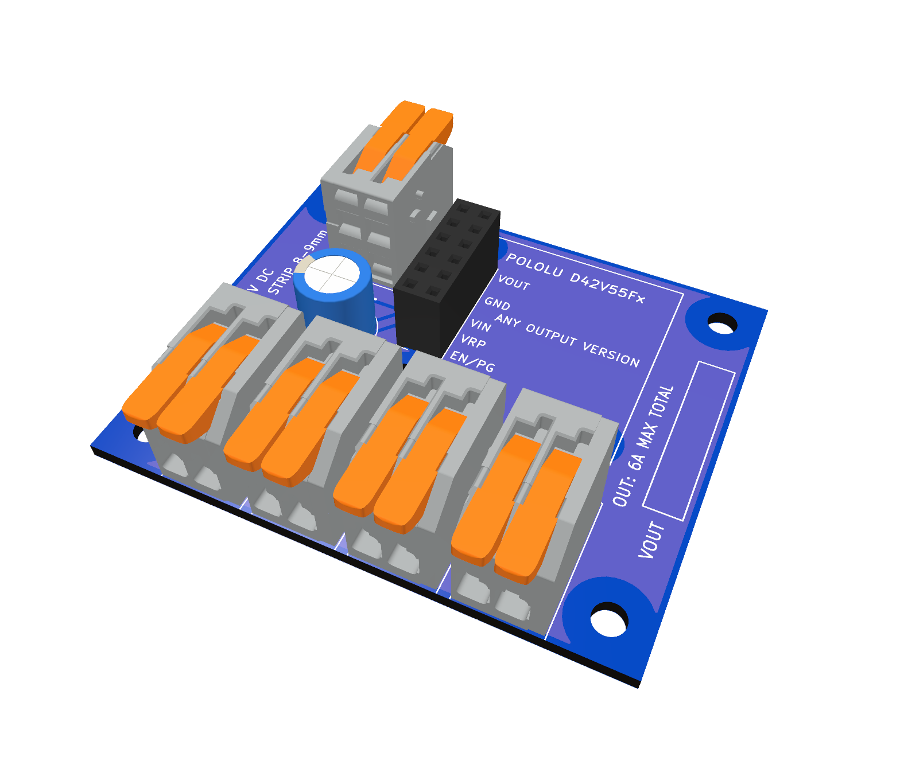
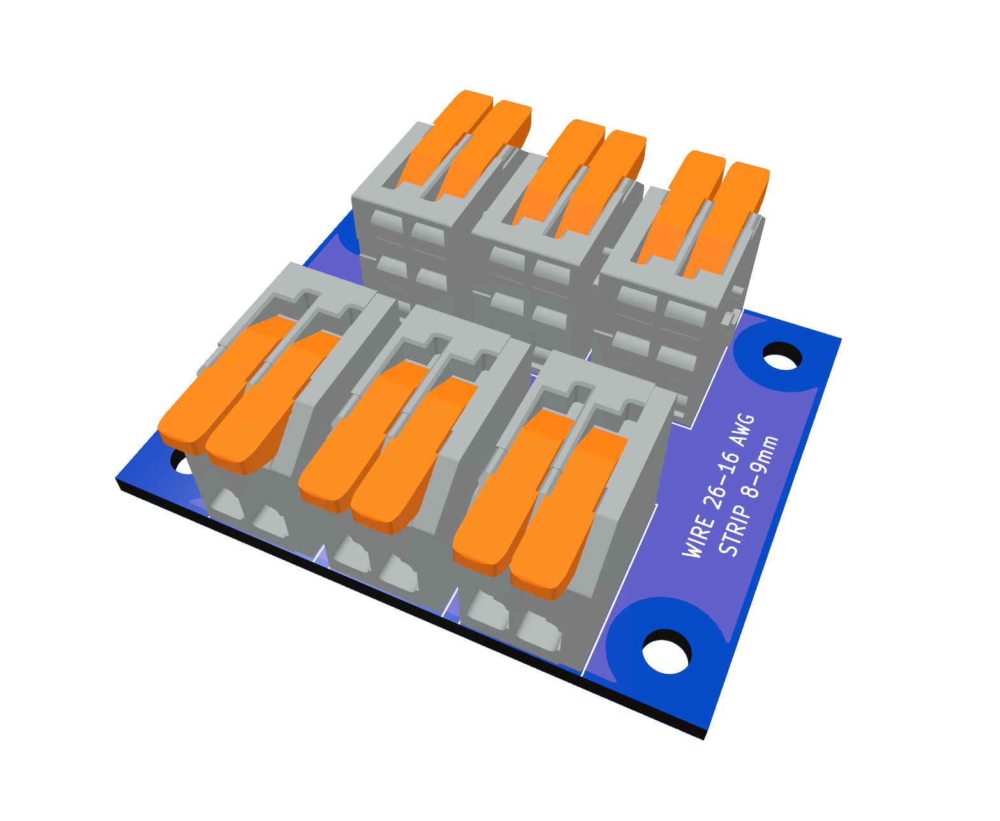
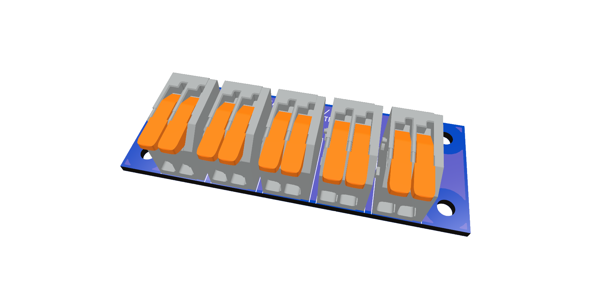

# Power Boards

Small PCBs for power regulation and distribution.

Each board's electrical design is written in [Stackup](https://github.com/stackup-eda/stackup) KDL, which
is the source of truth for the circuit; there are no KiCad schematics. The layout is done in KiCad
(currently 10), linked to the KDL through a `.stackup_sch` file and synced with the Stackup KiCad plugin.

## Boards

<p align="center">
  <a href="PCB/regulator"></a>
  <a href="PCB/distribution"></a>
  <a href="PCB/distribution-inline"></a>
</p>

| Board | Folder | Purpose | Status |
|---|---|---|---|
| Regulator | [`PCB/regulator/`](PCB/regulator) | A plug-in Pololu D42V55Fx regulator (any output version: 5 V, 12 V, ...) feeding four WAGO 2601 outputs over V+ and GND planes. 9-32 V in, 6 A out (5 A with the 12 V module) | Design done, first-pass layout |
| Distribution | [`PCB/distribution/`](PCB/distribution) | Six interchangeable power terminals in a 3 x 2 grid (any one can be the input) over shared V+ and GND planes, WAGO 2601 lever terminals. 17.5 A total | Initial layout done |
| Distribution, inline | [`PCB/distribution-inline/`](PCB/distribution-inline) | The distribution board with five terminals in a single row (65.5 x 24 mm). 17.5 A total | Initial layout done |

Each board's README has its ratings, a parts list with Mouser, DigiKey and LCSC numbers, assembly
steps and the design decisions behind it. The purchasing BOM for each is in
`PCB/<board>/production/bom/`.

## Repository layout

| Path | Contents |
|---|---|
| [`manifest.kdl`](manifest.kdl) | Stackup version and the parts library, pinned by commit. Shared by every board |
| `PCB/<board>/` | One folder per board: its KiCad project (`<board>.kicad_pro`, `.kicad_pcb`, `.stackup_sch`) and the folders below |
| `PCB/<board>/stackup/` | `board.kdl`, the board's circuit |
| [`PCB/libraries/stackup/`](PCB/libraries/stackup) | `parts.kdl`, the Stackup parts shared by every board |
| `PCB/<board>/diagrams/` | Layout floorplans for circuits with real layout stakes (switching loops, thermal pads, high-current paths) |
| `PCB/<board>/analysis/` | Generated analysis output. Only `manifest.json` is committed |
| `PCB/<board>/assets/` | Board renders used in the READMEs |
| `PCB/<board>/production/` | Fab outputs: `bom/` (the purchasing BOM), `gerbers/`, `jlcpcb/`, `placement/` |
| [`PCB/libraries/`](PCB/libraries) | KiCad footprints (`PowerBoards.pretty`) and 3D models shared by all boards |
| [`PCB/datasheets/`](PCB/datasheets) | Manufacturer datasheets for the parts used, shared by all boards |
| [`scripts/export_production.sh`](scripts/export_production.sh) | Regenerates every board's `production/` files |
| [`scripts/spice/`](scripts/spice) | ngspice simulations of the power, enable and protection circuits |
| [`graphics/`](graphics) | Logos and images |

To add a board, create `PCB/<board>/` with the same subfolders as an existing one and add it to the
table above.

## Working on a board

Run these from the repository root.

```bash
# Check the circuit
stackup check PCB/<board>/stackup/board.kdl

# Export the purchasing BOM
stackup bom PCB/<board>/stackup/board.kdl --locked -o <board>-bom.csv

# Regenerate the fab files (BOM, Gerbers, drills, placement, upload zip) for one board or all of them
scripts/export_production.sh [<board>]
```

After `stackup check` passes, open `PCB/<board>/<board>.kicad_pcb` in KiCad and sync it with the Stackup
plugin.

## Contributing

All changes go through pull requests; nothing is pushed directly to `main`. History is kept linear, so
PRs land by rebase.
